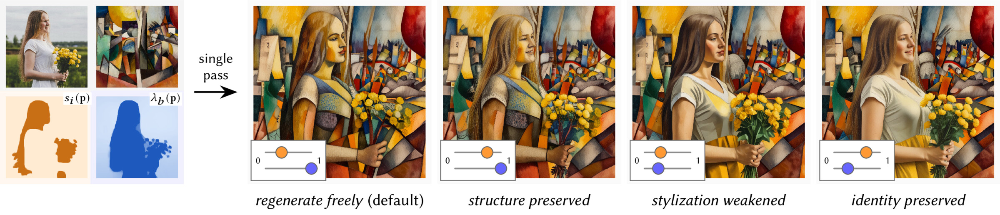

# Local Content-Style Control for Diffusion-based Image Stylization

[](https://www.amirsemmo.de/local-content-style-sa2026/)
[](https://arxiv.org/abs/2610.08704)
<!-- Venue badge: switch the link to https://doi.org/10.1145/3829339.3847814 once the DOI resolves (ACM publication). -->
[](https://arxiv.org/abs/2610.08704)
[](https://www.amirsemmo.de/local-content-style-sa2026/#video)
[](LICENSE)
[](https://github.com/huggingface/diffusers)

PyTorch/diffusers implementation of *Local Content-Style Control for Diffusion-based Image
Stylization*, Amir Semmo, SIGGRAPH Asia 2026 Technical Communications.



Two conditioning weights of a ControlNet + IP-Adapter stylization pipeline become per-pixel
maps, giving local, per-axis control of content and style in a single pass, without
retraining:

- **content map `s(p)`**: the ControlNet Union (Tile) conditioning strength per pixel,
  applied at the ControlNet input fusion and to the ControlNet output residuals
  (`src/lcsc/controlnet.py`);
- **style maps `λ_b(p)`**: the IP-Adapter scale per pixel for each of the 11 attention
  blocks (`src/lcsc/ip_adapter.py`, block table in `src/lcsc/blocks.py`).

A uniform map reproduces the stock diffusers behavior exactly.

Model stack, as in the paper: SDXL-Lightning 4-step UNet, ControlNet Union ProMax (Tile,
[`xinsir/controlnet-union-sdxl-1.0`](https://huggingface.co/xinsir/controlnet-union-sdxl-1.0)),
IP-Adapter Plus ViT-H, fp16-fix VAE; 4 trailing Euler steps, no classifier-free guidance
(`src/lcsc/pipeline.py`). The weights are downloaded from Hugging Face on first use.

## Installation

```bash
conda env create -f environment.yml
conda activate local-content-style
pip install -e .
```

or, in an existing Python 3.10+ environment with PyTorch:

```bash
pip install -e ".[demo,notebook]"
```

Runs on CUDA, Apple silicon (MPS) or CPU, in fp16. So far it has been tested on Apple silicon.
All weights take about 11.6 GB of GPU memory. On 16 GB GPUs such as Colab's T4, use
`LocalContentStyle.load(offload="encoders")` (or `--offload` for the demo and scripts): the text
and image encoders move to the GPU only while they run, which needs about 8.7 GB.
`offload="all"` (`--offload all`) keeps every model on the CPU until it runs; it needs the least GPU
memory but holds all weights in system RAM. Results are the same in every mode.

## Usage

```python
from lcsc import LocalContentStyle, Region

lcs = LocalContentStyle.load()           # CUDA, then MPS, then CPU; fp16
mask = "subject-mask.png"                # white = inside the region

image = lcs(
    "a young woman holding a bouquet of yellow flowers, cubist painting",
    content_image="photo.jpg",
    style_image="exemplar.jpg",
    content_strength=Region(mask, inside=0.35, outside=0.7),  # s(p): ControlNet Tile strength
    style_strength=Region(mask, inside=1.0, outside=0.3),     # lambda(p): IP-Adapter scale
    blocks="all",                        # or "style" (block 6), "mid+style" (4, 6), or indices
    seed=1447777030,
)
image.save("result.png")
```

A strength is a float (uniform), a map (image path, PIL image, 2-D array or tensor), or a
`Region` that remaps a mask to `outside + (inside - outside) * mask`. `block_strength={6: ...}`
overrides `style_strength` for individual active blocks, e.g. a depth map on the style block
only (Fig. 4, left):

```python
lcs("watercolor style", "scene.jpg", "homer.png", blocks="style", block_strength={6: "depth.png"})
```

Pass `noise="numpy"` to get the paper's composition for a paper seed (see below).
`examples/quickstart.ipynb` walks through both calls on the paper's inputs (`paper/Inputs`).

## Demo

```bash
python demo/app.py            # http://127.0.0.1:7860, --share for a public link
```

Brush a region to retouch (or upload a mask, white = region), set content *s* and style *λ*
inside and outside it, pick the IP-Adapter blocks, and render; the optional uniform baseline
uses the outside values everywhere. A separate content region is optional and defaults to the
style region. The paper's Fig. 1, Fig. 4 (left) and Fig. S2 cases load as examples.

## Reproducing the paper's examples

The figures in the paper were rendered with Digital Masterpieces' own Core ML pipeline, which
runs the same models and method on Apple devices. It draws its initial noise with NumPy's legacy
`RandomState` rather than diffusers' torch generator, so the same seed gives a different image
unless you ask for that noise: `noise="numpy"` in the Python API, `--noise numpy` for
`run_manifest.py` (both default to torch). `scripts/reproduce_paper.sh` passes it for you, and
`paper/Inputs` holds the exact 224×224 style exemplars the figures used, so its renders reproduce
the figures' compositions. What remains is numerical (8-bit weights, Neural Engine fp16): 21–27 dB
PSNR from the paper's renders.

`paper/` holds the paper's experiment manifests, their inputs (`paper/Inputs`, see
[LICENSES.md](LICENSES.md)) and the renders of this implementation (`paper/expected`).
`scripts/reproduce_paper.sh` re-renders Fig. 1, Fig. 4 (left, middle, right), Fig. S1 and
Fig. S2 and writes, per case, `outputs/<manifest>/<content>/<style>/seed-<seed>/comparison.png`
(expected renders above, this run below), the mean difference to the expected renders, and a
locality table (per condition, the mean |difference| to the baseline condition inside vs.
outside the region mask):

```bash
scripts/reproduce_paper.sh                   # add --offload on GPUs with less memory
scripts/reproduce_paper.sh --skip-existing   # reuse renders, rebuild comparisons only
```

Single manifests run with `scripts/run_manifest.py` (`--seeds`, `--styles`, `--crop`,
`--reference`, see `--help`); add `--noise numpy` to compare against `paper/expected`. On Apple
silicon, where the expected renders were made, a re-render differs from them only by JPEG
compression; other GPUs give small numerical differences.

**Compared with the paper's Core ML renders**: same compositions and edits, similar locality.
Mean |difference| from the baseline condition inside / outside the region mask (0..1):

| Figure | condition | this implementation | paper (Core ML) |
|---|---|---|---|
| Fig. 1 | C | 0.053 / 0.083 | 0.055 / 0.084 |
| Fig. 1 | S | 0.072 / 0.126 | 0.069 / 0.131 |
| Fig. 1 | CS | 0.084 / 0.156 | 0.084 / 0.163 |
| Fig. 4 left | L | 0.042 / 0.077 | 0.043 / 0.081 |
| Fig. 4 middle | L | 0.085 / 0.027 | 0.085 / 0.024 |
| Fig. 4 right | L | 0.129 / 0.095 | 0.133 / 0.103 |
| Fig. S1 | masked | 0.044 / 0.222 | 0.037 / 0.199 |

## Tests

Uniform maps must reduce to stock diffusers behavior:

```bash
python tests/test_uniform_equivalence.py
```

## Citation

```bibtex
@inproceedings{Semmo2026LocalContentStyle,
  author    = {Semmo, Amir},
  title     = {Local Content-Style Control for Diffusion-based Image Stylization},
  booktitle = {SIGGRAPH Asia 2026 Technical Communications},
  series    = {SA Technical Communications '26},
  year      = {2026},
  location  = {Kuala Lumpur, Malaysia},
  publisher = {Association for Computing Machinery},
  address   = {New York, NY, USA},
  isbn      = {979-8-4007-2841-9},
  doi       = {10.1145/3829339.3847814}
}
```

## License

Copyright 2026 Digital Masterpieces GmbH. Code: [Apache-2.0](LICENSE), see also
[NOTICE](NOTICE). Bundled images: see [LICENSES.md](LICENSES.md); the author's photographs are
CC BY 4.0, the Unsplash photographs are under the Unsplash License, and the style exemplars
are public-domain paintings. The teaser figure is from the paper (CC BY 4.0). The model weights
the pipeline downloads keep their own licenses.

## Acknowledgments

This work was funded by the Federal Ministry for Economic Affairs and Energy (BMWi), Germany,
for the ZIM project 16KN124010.
